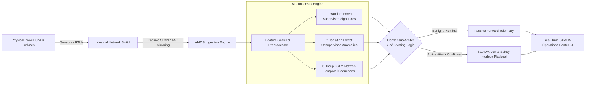

# AI-Driven Intrusion Detection System for Power Plant ICS 🏭⚡


An enterprise-grade, real-time Intrusion Detection System (IDS) engineered specifically for **Industrial Control Systems (ICS)**, **SCADA networks**, and **Operational Technology (OT)** environments. 

This project analyzes physical sensor telemetry, industrial communications (Modbus TCP, DNP3), and power grid frequency/voltage dynamics to detect targeted cyber-physical attacks—such as **False Data Injections (FDI)**, **SCADA DoS**, **Firmware Malware**, **Command Injections**, and **Substation Reconnaissance**—preventing cascading grid blackouts and turbine trips.

---

## 📑 Table of Contents
1. [Core Architecture & Detection Pipeline](#-core-architecture--detection-pipeline)
2. [Dataset & Cyber-Physical Justification](#-dataset--cyber-physical-justification)
3. [Machine Learning Ensemble & Consensus Arbiter](#-machine-learning-ensemble--consensus-arbiter)
4. [Real-Time SCADA Operations Center (Web Dashboard)](#-real-time-scada-operations-center-web-dashboard)
5. [Quickstart & Installation](#-quickstart--installation)
6. [Real-World Deployment Scenarios](#-real-world-deployment-scenarios)
7. [Real-World Limitations & Operational Constraints](#-real-world-limitations--operational-constraints)
8. [Repository Structure](#-repository-structure)

---

## 🏗️ Core Architecture & Detection Pipeline

Traditional IT network firewalls and intrusion systems fail in power plants because they only inspect generic web packets (HTTP, TLS, DNS) and are blind to **industrial protocol semantics** and **turbomachinery physics**. 

This system deploys a defense-in-depth pipeline that couples cyber telemetry features with physical grid state validation:



---

## 📊 Dataset & Cyber-Physical Justification

* **Dataset Source:** [Distributed Energy Cybersecurity Dataset (Kaggle)](https://www.kaggle.com/datasets/colabsss/distributed-energy-cybersecurity-dataset)
* **Dataset Size:** 15,000+ authentic multi-agent energy telemetry records (`Distributed_MultiAgent_Energy_Cybersecurity_Dataset.csv`).

### Why this dataset?
Most academic cybersecurity benchmarks (e.g., KDD99, NSL-KDD, CIC-IDS) represent campus office networks. In contrast, this dataset represents authentic **smart grid power plants**:
* **Physical Grid Telemetry:** Continuous voltage deviations ($\pm\%$), frequency fluctuations ($\pm\text{Hz}$ around nominal 50.00/60.00 Hz), active power (kW), and harmonic distortion (THD).
* **Industrial Protocols:** Mapped features reflecting DNP3 and Modbus TCP communication characteristics, SCADA command counts, and transmission latency.
* **Domain-Specific Attack Vectors:**
  1. `Normal`: Standard stable grid baseline operations.
  2. `False_Data_Injection`: Malicious spoofing of sensor measurements to trigger premature generator trips.
  3. `DoS_Attack`: Flooding industrial controllers to induce communication timeouts.
  4. `Replay_Attack`: Intercepting and resending historical nominal packets during sabotage.
  5. `Insider_Threat`: Unauthorized setpoint modifications from within the control zone.
  6. `Spoofing_Attack`: Masquerading as a trusted Remote Terminal Unit (RTU).
  7. `Command_Injection`: Unauthorized actuator override and valve commands.
  8. `Malware`: Malicious payload tampering with controller firmware routines.
  9. `Reconnaissance`: Port scans and register mapping across substation relays.

---

## 🧠 Machine Learning Ensemble & Consensus Arbiter

The detection core combines three complementary algorithms to minimize both **false negatives** (missed breaches) and **false positives** (nuisance plant shutdowns):

1. **Random Forest (Supervised Signature Classifier):**
   * Evaluates incoming 37-feature telemetry vectors against calibrated normal vs. malicious attack signatures (`rf_vote` triggered at probability $\ge 0.60$).
   * Delivers high-precision detection across known cyber-physical attack profiles present in the 9-class dataset.
2. **Isolation Forest (Unsupervised Physical Anomaly Profiler):**
   * Profiles nominal multidimensional boundaries and thermodynamic bounds of the grid (`iso_vote` triggered on outlier flag $-1$).
   * Flags zero-day anomalies and unexpected telemetry outliers without requiring labeled attack training samples.
3. **Deep LSTM Recurrent Neural Network (Temporal Sequence Model):**
   * Evaluates sequential time-series patterns over a 5-packet sliding FIFO window (`lstm_vote` triggered at risk score $\ge 0.55$).
   * Detects progressive, low-and-slow multi-stage sensor spoofing that evades single-packet static thresholds.

### 2-of-3 Consensus Arbiter Voting:
* **Nominal SCADA Forward:** If fewer than 2 models flag a breach (`votes < 2`), telemetry is safely forwarded and normal operation continues.
* **Safety Interlock Breaker Trip:** If **2 or more of the 3 independent models** affirmatively vote for an intrusion (`(rf_vote + iso_vote + lstm_vote) >= 2`), the arbiter engages the industrial safety breaker trip and logs the defense playbook action.

---

## 🖥️ Real-Time SCADA Operations Center (Web Dashboard)

A modern, responsive, cyber-industrial web operations center is provided in the [`ui/`](./ui/) folder.

```bash
cd ui
npm start
```
Access via browser at **`http://localhost:5050`**

### Visual & Interactive Capabilities:
* **Left Navigation Pill Dock:** Features dedicated function shortcuts with smooth-scrolling card targeting and a **single-cycle 1 mm laser border glow** (white in Dark Mode, black in Light Mode).
* **Cyber-Physical Oscilloscope:** Hardware-accelerated canvas visualizing real-time frequency and voltage deviations with synchronous lock indicators ($50.00\text{ Hz} \pm 0.03\text{ Hz}$).
* **AI Consensus Engine Gauges:** Live percentage readouts for Random Forest, Isolation Forest, and LSTM sequence risks with playbook recommendations (`FORWARD_TELEMETRY`, `ISOLATE_SUBNET`, `TRIP_BREAKER`).
* **Interactive Attack Injector:** One-click injection buttons with an adjustable rate slider ($0.5\text{s} - 10.0\text{s}$) to test detection resilience under live fire.
* **Industrial Alarm Siren:** Web Audio tone generator with audible chimes.
* **Theme Engine:** Auto (System), Dark, and Light mode support with frosted glassmorphism.

---

## ⚡ Quickstart & Installation

### 1. Prerequisites
* Python 3.8 to 3.11
* Node.js v16+ (v18/v20 LTS recommended)
* Git

### 2. Python Environment Setup
```bash
git clone https://github.com/your-org/AI-IDS-PowerPlant.git
cd AI-IDS-PowerPlant

# Create virtual environment
python3 -m venv venv
source venv/bin/activate  # On Windows: .\venv\Scripts\Activate.ps1

# Install required dependencies
pip install -r requirements.txt
```

### 3. Launch the Operations Center
```bash
cd ui
npm install
npm start
```
Open **[http://localhost:5050](http://localhost:5050)** in your browser.

*(For detailed headless CLI execution modes and standalone Python simulation pipelines, see [`installation_and_setup.txt`](./installation_and_setup.txt).)*

---

## 🌐 Real-World Deployment Scenarios

Where and how this system can be deployed on physical power plant and substation infrastructure:

| Deployment Case | Network Placement (Purdue Model) | Operating Principle | Ideal Use Case |
| :--- | :--- | :--- | :--- |
| **Case 1: Passive SPAN / TAP Mirroring** | **Level 1 & 2** (Control Bus / Cell Network) | Ingests mirrored packets from industrial switches (out-of-band) via Scapy/AF_PACKET sockets. Zero disruption to real-time control loops. | Thermal, hydro, and nuclear power plant turbine control rooms. |
| **Case 2: Industrial Edge Micro-Appliance** | **Level 1** (Feeder / Substation Edge) | Deployed on ruggedized DIN-rail Industrial PCs (Moxa, Advantech, Raspberry Pi CM4) at remote distribution cabinets. | Remote wind farms, solar PV parks, and battery storage systems (BESS). |
| **Case 3: SCADA Historian Advisory Layer** | **Level 3** (Plant Operations Supervisory) | Ingests decrypted telemetry streams from OPC-UA servers or MQTT brokers every 500ms–2000ms to detect low-and-slow manipulation. | Energy Management Systems (EMS) and regional transmission operations. |
| **Case 4: Hardware-in-the-Loop (HIL) Testbeds** | **Certification / Cyber-Range Labs** | Connected to real-time digital simulators (RTDS, OPAL-RT) and physical PLCs (Siemens S7-1500, Rockwell ControlLogix). | Utility cyber resilience testing and regulatory pre-commissioning validation. |

---

## ⚠️ Real-World Limitations & Operational Constraints

Deploying machine learning models in critical infrastructure demands a rigorous understanding of physical safety constraints:

1. **Inference Latency vs. Sub-Cycle Electrical Relaying:**
   * Electrical protective relays (e.g., SEL-411L) operate at sub-cycle speeds (**4 ms to 16 ms**) to prevent transformer explosions.
   * AI inference pipelines (scaling, feature extraction, LSTM recurrence) take **15 ms to 45 ms**.
   * *Rule:* The AI-IDS must serve as a **supervisory cybersecurity monitoring layer**, not as a substitute for primary electromechanical protective relays.

2. **Physical Transients vs. Malicious Anomalies:**
   * Grid events such as lightning strikes, large inductive motor startups, and capacitor bank switching create sudden non-malicious telemetry spikes.
   * Unsupervised models (Isolation Forest) flag statistical rarity. To prevent false breaker trips, the system mandates a **2-out-of-3 Consensus interlock**.

3. **Encrypted Industrial Communication (IEC 62351 & DNP3-SAv5):**
   * If OT traffic is encrypted end-to-end, payload register inspection requires either TLS termination proxies, pre-shared key escrow, or application-layer ingestion via OPC-UA.

4. **Seasonal Concept Drift & Renewables Intermittency:**
   * Seasonal load variations (summer cooling vs. winter heating) shift normal operational distributions.
   * Production models require scheduled periodic re-calibration (every 3 to 6 months) to maintain high baseline fidelity.

5. **Resource Constraints on Legacy PLCs:**
   * Deep learning frameworks (TensorFlow/Keras) cannot execute directly inside 16-bit or 32-bit embedded microcontrollers. The IDS must reside on an adjacent industrial edge PC.

6. **In-Line vs. Fail-Open Protocol:**
   * In power systems, dropping a legitimate control command (such as an emergency pressure vent) can cause catastrophic mechanical failure. The system should operate in **passive detection and advisory alert mode** with human-in-the-loop verification for critical disconnections.

---

## 📂 Repository Structure

```
.
├── Distributed_MultiAgent_Energy_Cybersecurity_Dataset.csv # Authentic OT telemetry records
├── AI-Driven_Intrusion_Detection_for_Energy_and_Power_Plant_ICS.ipynb # Model training pipeline
├── stream_generator.py                   # Multi-class authentic telemetry stream simulator
├── detect.py                             # Real-time CLI inference engine
├── grid_physics.py                       # Physical grid frequency/voltage deviation model
├── live_stream.json                      # Live telemetry buffer
├── live_detection.json                   # Real-time multi-model inference scores & arbiter verdict
├── stream_config.json                    # Dynamic rate and active injection configuration
├── requirements.txt                      # Python dependencies manifest
├── installation_and_setup.txt            # Comprehensive deployment & limitations manual
├── README.md                             # Primary documentation
├── package.json                          # Root repository scripts
├── rf_powerplant_ids.pkl                 # Serialized Supervised Random Forest
├── iso_powerplant_ids.pkl                # Serialized Unsupervised Isolation Forest
├── lstm_powerplant_ids.keras             # Serialized Deep Learning LSTM Model
├── scaler_powerplant_ids.pkl             # Fitted StandardScaler weights
└── ui/                                   # Real-Time SCADA Operations Center Dashboard
    ├── server.js                         # Node.js SSE & REST streaming server
    ├── package.json                      # Web UI package configuration
    └── public/
        ├── index.html                    # Glassmorphism cyber-industrial SOC interface
        ├── style.css                     # B&W monochrome design system with 1mm border glow
        ├── app.js                        # Client-side state arbiter & audio engine
        └── grid_physics.js               # Oscilloscope physics simulation module
```

---

## 🛡️ License & Ethical Use Notice
This repository is developed for educational, academic research, and critical infrastructure defensive purposes. All testing on physical industrial hardware must be performed in isolated, non-energized test environments or certified cyber-range testbeds.
