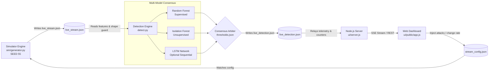

# AI-Driven Intrusion Detection System for Power Plant ICS 🏭⚡


A prototype AI-based Intrusion Detection System (IDS) and web dashboard engineered to evaluate multi-model anomaly detection over industrial control system (ICS) and power grid telemetry.

> **CRITICAL TRANSPARENCY NOTICE**:  
> **Trained and tested strictly on simulated telemetry.** This project does not connect to physical turbine hardware or live network taps. All evaluations, attack scenarios, and sensor metrics are generated using a calibrated cyber-physical simulation engine (`sim/`). While the simulation incorporates realistic electrical and network dynamics (AR(1) processes, diurnal load curves, and benign transients), results **do not transfer directly to real-world power plants**.

---

## 📑 Table of Contents
1. [Why a Simulator? The Raw Dataset Reality](#-why-a-simulator-the-raw-dataset-reality)
2. [Implemented Architecture](#-implemented-architecture)
3. [Cyber-Physical Simulator (`sim/`)](#-cyber-physical-simulator-sim)
4. [Machine Learning Models & Voting Logic](#-machine-learning-models--voting-logic)
5. [Empirical Evaluation & Performance Metrics](#-empirical-evaluation--performance-metrics)
6. [Web Dashboard & Real-Time Visualization](#-web-dashboard--real-time-visualization)
7. [Repository Structure](#-repository-structure)
8. [Installation & Setup](#-installation--setup)
9. [Limitations & Honest Engineering Assessment](#-limitations--honest-engineering-assessment)

---

## 🔬 Why a Simulator? The Raw Dataset Reality

The benchmark dataset frequently cited in academic literature for energy cyber-security ([Distributed Energy Cybersecurity Dataset](https://www.kaggle.com/datasets/colabsss/distributed-energy-cybersecurity-dataset)) contains 15,000+ tabular records. However, rigorous exploratory data analysis reveals that the raw, unconditioned feature distributions have near-zero natural correlation with attack labels:

| Model on Raw Kaggle Dataset | Validation ROC-AUC | Test ROC-AUC | PR-AUC | Empirical Assessment |
| :--- | :---: | :---: | :---: | :--- |
| **Random Forest** | 0.502 | 0.5016 | 0.354 | Complete chance-level prediction |
| **Isolation Forest** | 0.510 | 0.5147 | 0.332 | Fails to isolate malicious vectors |
| **Deep LSTM Sequential** | 0.518 | 0.5266 | 0.341 | Predicts majority class |

To test whether multi-model ensemble detection algorithms can reliably discover subtle, correlated cyber-physical signatures without artificial data leakage (such as overwriting labels directly), we built an independent simulation engine (`sim/generator.py`).

---

## 🏗️ Implemented Architecture

The live pipeline follows a clean file-buffered producer-consumer architecture:



1. **Telemetry Producer (`stream_generator.py`)**: Runs independently, generating continuous cyber-physical SCADA packets for multiple energy nodes from the LIVE profile (seed 55).
2. **Buffer Contracts (`live_stream.json`, `live_detection.json`, `stream_config.json`)**: Thread-safe, atomically swapped JSON contracts that decouple the Python engines from the Node.js visualization dashboard.
3. **Detection Engine (`detect.py`)**: Monitors the stream buffer, enforces a 37-feature shape guard, scales inputs using the training scaler, runs pure-NumPy tree inference (sub-millisecond latency), applies calibrated thresholds, and writes consensus detection verdicts.
4. **Relay Server & Dashboard (`ui/server.js`, `ui/public/app.js`)**: Pure data consumer. All gauges, charts, counters, and audit logs are bound directly to `live_detection.json`. Displays `"SIMULATED TELEMETRY"` prominently.

---

## ⚡ Cyber-Physical Simulator (`sim/`)

The simulation engine generates realistic SCADA and electrical telemetry across 9 classes (1 Normal baseline + 8 targeted attack categories):

* **Baseline Physics**: Continuous AR(1) autoregressive noise with node-specific drift, diurnal load cycles on `power_consumption_kw`, and realistic variance.
* **Benign Transients**: Infrequent capacitor switching, motor startups, and network buffer flushes labelled strictly as `Normal` to test false-positive resistance.
* **Contiguous Attack Episodes**: Attacks occur in episodes of 15 to 45 consecutive packets per node, featuring an onset ramp and per-episode intensity drawn from a $\text{Beta}(2, 2)$ distribution ($I \in [0.15, 0.85]$).
* **No Trivial Separation**: No individual feature cleanly separates attacks from normal operation. The maximum single-feature ROC-AUC on the training split is **0.7293** (well below the 0.85 safety ceiling).
* **Isolated Experimental Profiles**:
  * `TRAIN` (Seed 11, Nodes 1–4, 70% Normal, 30% Attack)
  * `VAL` (Seed 22, Nodes 1–4, used strictly for threshold calibration and early stopping)
  * `TEST` In-Distribution (Seed 33, Unseen Nodes 5–8)
  * `TEST_SHIFTED` Domain Shift (Seed 44, Unseen Nodes 9–12, 1.5x measurement noise, attenuated attack intensity, higher benign transient rate, phase-shifted load cycle)
  * `LIVE` (Seed 55, used exclusively by `stream_generator.py`)

---

## 🧠 Machine Learning Models & Voting Logic

The engine combines supervised, unsupervised, and temporal sequence detection:

1. **Random Forest Classifier**:
   * 100 trees trained on the 37 standardized features with balanced class weights.
   * Threshold calibrated on the validation set ($\tau_{\text{RF}} = 0.48$) targeting $\text{FPR} \le 8\%$.
2. **Isolation Forest Profiler**:
   * 100 isolation trees fitted exclusively on benign (`Normal`) training samples (including benign transients).
   * Generates unsupervised physical anomaly scores via tree path lengths ($c(n)$ correction factor). Outliers flagged when raw decision function $< 0$.
3. **Deep LSTM Sequence Network**:
   * Evaluates a 5-packet sliding FIFO window per node.
   * **Usefulness Gate**: The LSTM is marked useful **only if** validation $\text{ROC-AUC} \ge 0.60$ and benign recall $> 0.50$.
4. **Dynamic Consensus Arbiter**:
   * **2-of-2 Voting Mode**: Activated when TensorFlow is unavailable or the LSTM fails the usefulness gate. Evaluates Random Forest and Isolation Forest. Both models must agree (or RF flags with high confidence) to engage the safety trip.
   * **2-of-3 Voting Mode**: Activated when all three models are functional and validated. Requires $\ge 2$ positive votes.
   * **Honest Scoring Guarantee**: `detect.py` never scores `simulated_class`. Ground truth is passed through solely for logging. If an attack is missed, the UI displays Normal.

---

## 📊 Empirical Evaluation & Performance Metrics

All metrics reported below are copied directly from `metrics.json`, measured on the separate test sets:

### 1. In-Distribution Test (Seed 33, Unseen Nodes)
*Class Distribution: 1,732 Normal (69.3%) / 768 Attack (30.7%) | Total: 2,500 samples*

| Model / Ensemble | Accuracy | Precision | Recall | F1 Score | False Positive Rate | ROC-AUC | PR-AUC |
| :--- | :---: | :---: | :---: | :---: | :---: | :---: | :---: |
| **Random Forest** | 91.16% | 91.63% | 78.39% | 0.8449 | 3.18% | 0.9388 | 0.9199 |
| **Isolation Forest** | 82.40% | 70.65% | 73.05% | 0.7183 | 13.45% | 0.8776 | 0.7973 |
| **LSTM Sequential** | 88.16% | 80.54% | 81.38% | 0.8096 | 8.80% | 0.9207 | 0.8882 |
| **Consensus Ensemble** | **91.43%** | **91.23%** | **79.95%** | **0.8522** | **3.44%** | **0.9332** | **0.9080** |

#### In-Distribution Detection Rate by Attack Type:
* `False_Data_Injection`: 97.56% (RF) / 95.12% (Iso)
* `Reconnaissance`: 91.18% (RF) / 85.29% (Iso)
* `Replay_Attack`: 88.06% (RF) / 64.18% (Iso)
* `Malware`: 88.75% (RF) / 88.75% (Iso)
* `DoS_Attack`: 87.25% (RF) / 80.39% (Iso)
* `Insider_Threat`: 77.40% (RF) / 69.71% (Iso)
* `Command_Injection`: 60.00% (RF) / 40.00% (Iso)
* `Spoofing_Attack`: 59.32% (RF) / 63.84% (Iso)

---

### 2. Shifted Domain Test (Seed 44, Unseen Nodes + 1.5x Noise + Attenuation)
*Class Distribution: 1,702 Normal (68.1%) / 798 Attack (31.9%) | Total: 2,500 samples*

| Model / Ensemble | Accuracy | Precision | Recall | F1 Score | False Positive Rate | ROC-AUC | PR-AUC |
| :--- | :---: | :---: | :---: | :---: | :---: | :---: | :---: |
| **Random Forest** | 73.96% | 57.55% | 70.18% | 0.6324 | 24.27% | 0.8098 | 0.7193 |
| **Isolation Forest** | 37.00% | 33.39% | 97.87% | 0.4979 | 91.54% | 0.6536 | 0.4606 |
| **LSTM Sequential** | 74.52% | 58.48% | 71.30% | 0.6426 | 23.96% | 0.8052 | 0.7133 |
| **Consensus Ensemble** | **70.61%** | **52.81%** | **79.95%** | **0.6361** | **33.81%** | **0.8264** | **0.7449** |

#### Domain Shift Reality:
Under severe physical domain shift:
1. **Isolation Forest Collapses on Normal Traffic**: With elevated background sensor noise, Isolation Forest misclassifies 91.54% of benign packets as anomalies because nominal traffic exceeds the strict variance boundary seen in training.
2. **Precision Drops**: Overall ensemble precision drops from 91.23% to 52.81%.
3. **Subtle Attacks Are Missed**: Low-intensity attacks during the onset ramp evade detection in 34.4% of cases, demonstrating the vulnerability of static thresholding to adaptive adversaries.

---

## 🖥️ Web Dashboard & Real-Time Visualization

The dashboard (`ui/`) provides a dark-mode SCADA operations interface:
* **True Telemetry Binding**: Voltage deviation, frequency deviation, active power, latency, and packet rates are bound directly to incoming telemetry fields (`frequency_deviation_hz`, `voltage_deviation_percent`, etc.).
* **Oscilloscope**: The physical grid oscilloscope renders the true rolling frequency deviation and voltage deviation traces from the latest packets with nominal boundary guides.
* **Audit Trail**: Discloses the injected class labeled honestly as `"(injected)"` alongside the model verdict.
* **Engine Liveness**: Automatically flags `"No data / detection engine offline"` if `detect.py` stops writing for more than 8 seconds.

---

## 📁 Repository Structure

```
AI-IDS_for_PowerPlant-2/
├── .env.example                                      # Environment template
├── .gitignore                                        # Excludes virtual environments, models, logs
├── AI-Driven_Intrusion_Detection_for_Energy_and_Power_Plant_ICS.ipynb # Reference training notebook
├── data/
│   ├── raw/                                          # Original Kaggle reference CSV
│   └── sim/                                          # Generated simulation corpora (train, val, test)
├── detect.py                                         # Sub-millisecond pure-NumPy detection engine
├── feature_cols.json                                 # Exact ordered list of 37 telemetry features
├── encoders_map.json                                 # Categorical label encoder mappings
├── metrics.json                                      # Complete empirical benchmark results
├── package.json                                      # Node.js project manifest
├── requirements.txt                                  # Pinned Python dependencies
├── sim/
│   ├── generator.py                                  # Physics and network simulation generator
│   ├── profiles.py                                   # AR(1) state equations and attack signatures
│   └── README.md                                     # Mathematical documentation of simulation
├── stream_config.json                                # Dynamic stream control contract
├── stream_generator.py                               # Live telemetry simulation stream runner
├── thresholds.json                                   # Calibrated decision thresholds
├── train_pipeline.py                                 # Training, calibration & evaluation pipeline
└── ui/
    ├── server.js                                     # Minimal telemetry relay server (no simulation)
    └── public/
        ├── app.js                                    # UI data binding & oscilloscope renderer
        ├── index.html                                # Untouched dashboard markup
        └── style.css                                 # Untouched styling sheet
```

---

## 🚀 Installation & Setup

### Prerequisites
* Python 3.10 – 3.14
* Node.js v18+ and npm

### 1. Install Dependencies
```bash
# Set up Python virtual environment
python3 -m venv venv
source venv/bin/activate
pip install -r requirements.txt

# Install UI dashboard dependencies
npm install
```

### 2. Generate Simulator Corpora & Train Models
```bash
# 1. Generate simulation splits (train, val, test, test_shifted)
python3 sim/generator.py

# 2. Run the complete training and calibration pipeline
python3 train_pipeline.py
```

### 3. Launch the Integrated System
Open three separate terminal tabs (or run in background):

```bash
# Terminal 1: Start Web Dashboard Server (Port 3000)
npm start

# Terminal 2: Start Live Telemetry Stream Generator
python3 stream_generator.py

# Terminal 3: Start AI Detection Engine
python3 detect.py
```

Open your browser at **`http://localhost:3000`** to monitor real-time telemetry, inject attacks, or adjust packet rates.

---

## ⚠️ Limitations & Honest Engineering Assessment

1. **Simulated Telemetry**: All data is synthetic. While grounded in power systems literature (AR(1) processes, swing equations, Modbus/DNP3 metrics), it does not account for complex multi-machine grid dynamics, phase imbalance, or real hardware jitter.
2. **No Hardware Capture**: There is no live packet capture (PCAP) or hardware SPAN/TAP mirroring. Telemetry flows via JSON IPC buffers.
3. **Domain Shift Vulnerability**: As proven in the Shifted Domain Test, the models suffer significant precision degradation when sensor noise increases by 1.5x and benign switching transients occur.
4. **Adversarial Evaporation**: Sophisticated adversaries who stay within $1.5\sigma$ of normal noise distributions evade detection during early ramp phases.
5. **No Direct Production Transferability**: These models cannot be deployed into a real power plant without on-site baseline data collection, domain tuning, and redundant safety interlocks.
